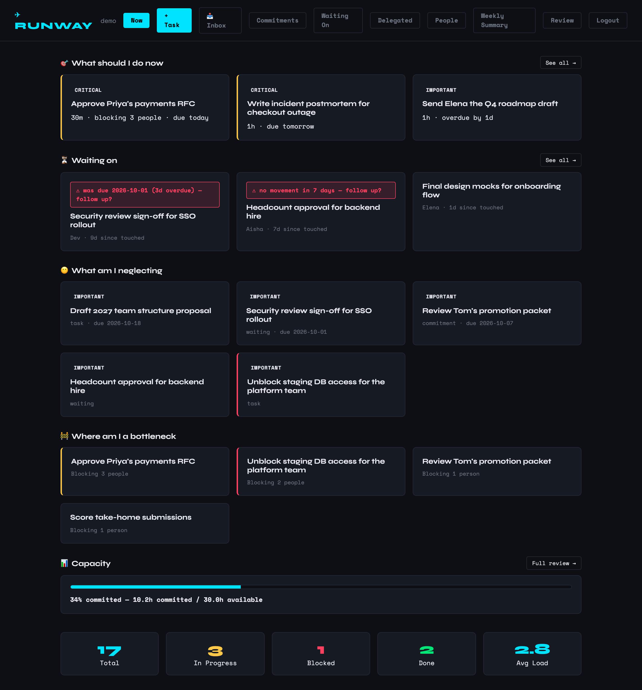
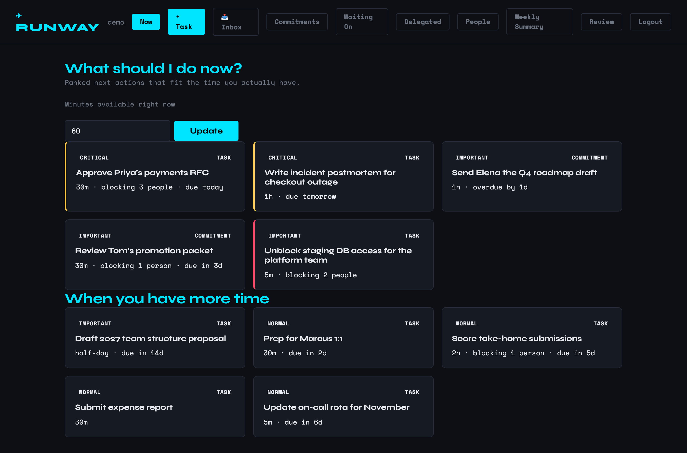

# Runway


A personal cognition aid for Engineering Managers — not another task tracker. An EM juggles incidents, RFCs, 1:1s, hiring, and delivery work in the same afternoon, plus the promises they've made, the people they're waiting on, and the work they've handed off. Runway's job is to answer, at a glance: **what should I do right now, what am I waiting on, what am I neglecting, and where am I a bottleneck** — deriving that from state, time, and relationships instead of just listing tasks.



The `/now` view ranks what fits the time you have and says why each item is next:



*(Screenshots use fictional demo data.)*

## How it was built

I'm an engineering manager, not a working developer, and I built it with Claude Code doing most of the typing with me reviewing every change. My job was the same one I'd do on any team: decide what we're building, set the bar and check the work against it.

The product and design decisions were mine. For example, keeping recommend.py and capacity.py as pure functions so the ranking logic could be tested without the app. I set the engineering standards before much code existed: tests for every module, lint and type checks in CI on every push, server-side validation that mirrors the schema constraints, and rate limiting on auth. Those standards reside in AGENTS.md, which is the brief the agent works from.

## Quickstart

```bash
python3 -m venv venv && source venv/bin/activate && pip install -r requirements.txt
sqlite3 runway.db < schema.sql
```

Copy `.env.example` to `.env` and set `SECRET_KEY` — the app won't start without it.

```bash
cp .env.example .env
python3 -c "import secrets; print(secrets.token_hex(32))"  # paste the output into .env
```

```bash
flask --app app:app run --debug
```

The AI features — quick-add (freeform text → classified item) and the opt-in weekly AI recap (`WEEKLY_SUMMARY_AI_ENABLED=1`) — run on a local model in [LM Studio](https://lmstudio.ai) (`LLM_BASE_URL` / `LLM_MODEL`); no API key is needed and nothing you type leaves your machine. The app runs fully without LM Studio; those features fall back to manual entry / the raw numbers. Every AI call is traced to a local `traces.db`. See `.env.example` for details.

### Docker

```bash
docker build -t runway .
docker run -e SECRET_KEY=$(python3 -c "import secrets; print(secrets.token_hex(32))") -p 8000:8000 runway
```

Bootstraps a fresh `runway.db` inside the container on first run. It's a single-user local tool at heart, so the database isn't persisted across rebuilds unless you mount a volume over `/app/runway.db` — this image is meant for a quick local look, not a deployment target.

## Tests

```bash
pip install -r requirements-dev.txt
ruff check .      # lint
mypy .            # type check
pytest tests/ -v
```

158 tests covering auth, CSRF, rate limiting, the global error handler, item capture/classification, the recommendation engine, relationship surfaces (commitments/waiting/delegated/people), weekly review + capacity, the assembled dashboard, and the schema migrations. CI runs lint, type checks, and the suite on every push/PR to `main`; Dependabot keeps dependencies patched weekly.

## What it does

Runway is built around one item model — `stream` (`task` / `commitment` / `delegation` / `waiting`) plus an optional `person` — seen from four angles:

| Surface | Route | Answers |
|---|---|---|
| **Capture** | `/add`, `/quick-add` | Turn a line of freeform text into a classified item — type, priority, effort, person, and stream — via an optional local-model extraction step, or fill it in by hand. |
| **Now** | `/now` | A ranked, time-box-aware list of what to work on next, with a plain-English reason on each ("10m · blocking 3 people"). Excludes anything that doesn't fit the time you have, with a smallest-first fallback if nothing does. |
| **Relationships** | `/commitments`, `/waiting`, `/delegated`, `/people` | Promises you've made, what you're waiting on, what you've delegated — grouped by person, aged, with a follow-up action on stale or overdue items. |
| **Review** | `/review` | The Friday ritual: completed/carried-forward/delegated/waiting counts, a time breakdown by type and by reactive-vs-proactive mode, a capacity read against your available hours, delegation suggestions, and a carry-forward reset. |
| **Dashboard** | `/` | All of the above, composed onto the landing page — a Now teaser, a Waiting-on teaser, a neglected-high-priority-items widget, a bottleneck widget, and a capacity snapshot — above the underlying kanban board of every task. |

## Data model

- `tasks` — the core item table. `stream` and the EM taxonomy (`item_type`, `priority`, `effort_minutes`, `mode`), plus free-text `blast_radius` and `sprint`; `person_id`, `is_blocking`, and `last_touched_at` drive the relationship and staleness signals.
- `people` — a lightweight directory (name/role/notes), the join point for commitments, delegation, and waiting-on.
- `events` — append-only history (`created`, `touched`, `status_changed`, `completed`, `delegated`, `followed_up`, ...). Weekly-review counts and staleness are always derived from this log, never from mutating a row in place.
- `settings` — per-user key/value store (`available_hours`, `meeting_hours_this_week`) for the capacity read.

Full column-level detail and the enum lists (`VALID_STREAMS`, `VALID_ITEM_TYPES`, etc.) live in `AGENTS.md`.

## Engineering notes

- **Module split**: `app.py` holds routing, validation, auth, and a few small pure helpers used directly by its own routes (e.g. relationship aging/escalation). `db.py` holds every query (one function per read/write, plus the append-only `log_event`). `classify.py` holds the AI features (extraction and the weekly recap), which call a local model through the single `llm.py` interface. `recommend.py` and `capacity.py` are pure functions — no DB, no Flask, no network — so the ranking and aggregation logic is unit-tested directly against plain data, not through the app.
- **Migrations**: `schema.sql` is the complete schema and bootstraps a fresh install on its own. `migrate_slice0.py`, `migrate_slice_d.py` and `migrate_retire_legacy_fields.py`, run in that order, bring an older `runway.db` to the same schema, idempotently; a test checks that they do.
- **Validation**: server-side validation mirrors the `CHECK` constraints in `schema.sql` — bad input gets a flash message, not a stack trace.
- **Error handling**: a global exception handler logs the full traceback server-side and returns a generic response to the client either way, whether or not `--debug` was left on by accident.
- **Rate limiting**: `/login` and `/register` are rate-limited per-IP to slow brute-force attempts.
- **Logging**: structured, leveled logs for auth events (login/logout/register, failed attempts) — never raw passwords.
- **Runs reliably in the background**: a Gunicorn + launchd setup (`deploy/`) that self-heals if the process crashes, without auto-starting on login/reboot. See `AGENTS.md` for the exact commands.

Deeper technical notes and the full build history live in `AGENTS.md`, `docs/product-brief.md`, and `docs/technical-design.md`.

## Project layout

| Path | Purpose |
|---|---|
| `app.py` | Routes, auth, validation, error handling, rate limiting, logging |
| `db.py` | Every database query and write, plus the append-only event log |
| `classify.py` | AI extraction — freeform text into a classified item |
| `recommend.py` | The pure "what should I do now" ranking engine |
| `capacity.py` | Pure weekly-review and dashboard aggregations |
| `events.py` | Read-only event-history helpers |
| `schema.sql`, `migrate_*.py` | Fresh-install schema, and the upgrade chain for an existing DB |
| `templates/` | Jinja2 templates for every surface above |
| `static/` | Dark-themed CSS and a small `fetch()`-based status-update script |
| `tests/` | pytest suite (mirrors the module split) |
| `deploy/` | launchd config for running in the background |
| `Dockerfile`, `docker-entrypoint.sh` | Minimal container image for local/demo use |

## Design choices

**One item table with a `stream` discriminator, not four separate lists.** "Waiting on", "delegated", and "commitment" are the same relationship seen from different angles — modeling direction plus time, rather than four parallel tables, is what lets the Now/Waiting/Delegated/Review surfaces all read from one place.

**The recommendation and capacity engines are pure functions.** No DB access, no LLM call — inputs are plain data, output is a ranked list or a computed aggregate. That's what makes the "25 minutes before a meeting shouldn't suggest a 2-hour doc" behavior, and the weekly capacity math, densely unit-testable without spinning up the app.

**Blast radius alongside priority.** Priority says how much an item matters to me; blast radius names who or what is blocked if it slips, which is the context I need when deciding whether to chase or delegate it.

**SQLite + vanilla JS over Postgres + a frontend framework.** This is a single-user local tool, not a service with concurrent writers. `cs50.SQL` keeps queries readable, and a handful of `fetch()` calls are all the interactivity the UI needs — reaching for a framework here would be solving a problem this app doesn't have.
